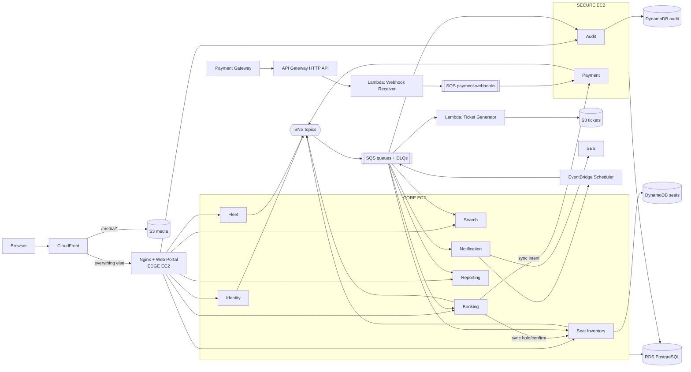
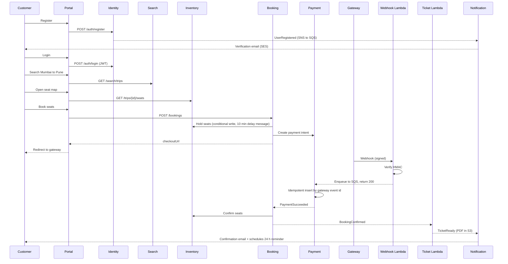

# RouteGo: Overall Architecture

A bus-booking platform built as a hands-on AWS DevOps teaching project. Every AWS service in it exists because a requirement needs it, so the instructor can always say "without this, X breaks."

**How to read this document set**
- This file: system-level BRD, PRD, FRD, architecture, flows, build order, catalogs, platform setup, local environment.
- `services/NN-*.md`: one file per service, each with its own BRD, PRD, FRD, dependencies, AWS usage, prerequisites, local run, AWS deployment, and labs.

**Assumptions** (change them in one place if the teacher disagrees)
- Region: `ap-south-1` (configurable through `AWS_REGION`). One AWS account, one environment called `prod` (used as a teaching "production").
- Stack: current .NET LTS, PostgreSQL + Dapper, Razor Pages, vertical slice architecture inside each service. Migrations use DbUp.
- Payment gateway: sandbox only. A small `MockGateway` container is used for deterministic classroom demos (see `06-payment.md`).
- Currency INR, one time zone for display (IST), all timestamps stored as UTC.

---

## 1. System BRD (Business Requirements)

### 1.1 Purpose
Let customers find and book bus seats reliably, let operators sell inventory, and give the business control over payments, refunds, and reporting.

### 1.2 Business objectives
| ID | Objective |
|---|---|
| BO-1 | A customer completes a booking in under 3 minutes. |
| BO-2 | No seat is ever sold twice. |
| BO-3 | No payment is ever lost: every successful payment ends as a confirmed booking or an automatic refund. |
| BO-4 | Festival-season spikes are absorbed without manual intervention. |
| BO-5 | Operators and admins see trustworthy, near-real-time sales data. |
| BO-6 | Infrastructure cost stays low enough for a startup and a classroom. |

### 1.3 Stakeholders
| Persona | Needs |
|---|---|
| Customer | Search, book, pay, receive ticket, cancel, get refund |
| Operator | Add buses, routes, schedules, fares; see sales |
| Admin / Support | Approve operators, handle disputes, view audit trail |
| Finance | Daily settlement report |
| Instructor / Students | Each phase demoable; every AWS service has a visible reason |

### 1.4 Scope
- **In scope:** onboarding, catalog, search, seat hold, payment, confirmation, e-ticket, notifications, cancellation and refund, operator dashboard, admin reports, audit.
- **Out of scope:** flights, hotels, wallet, dynamic pricing, mobile apps, live tracking, multi-language, real settlement, reviews system (operator rating is a seeded field).
- **Phase 2 hook:** hotels as a second inventory type; coupons.

### 1.5 Non-functional requirements
| Area | Requirement |
|---|---|
| Availability | Booking works even if email or ticket generation is down |
| Scalability | Search and booking scale independently |
| Reliability | No lost payments; failed async work is retried and visible |
| Security | No credentials in code or config files; least privilege; PII protected |
| Performance | Search under 1 s; seat map under 500 ms |
| Observability | Central logs, metrics, alarms for DLQs, 5xx, queue age |
| Deployability | Every service containerized; deploy by pipeline with no manual server steps |
| Cost | Few small instances; serverless only where it fits |
| Auditability | Who did what and when, kept for finance disputes |

### 1.6 Success criteria (the demos)
1. 100 concurrent requests for one seat: exactly one succeeds.
2. Kill Notification mid-booking: the booking still confirms, and the email arrives after recovery.
3. Replay one payment webhook 5 times: exactly one booking.
4. Leave a seat held: it releases itself at 10 minutes.
5. Payment arrives after the hold expired: automatic refund.
6. Push to Git: the service deploys itself.

---

## 2. System PRD (Product Requirements)

**Product:** RouteGo, an intercity bus booking platform.

### 2.1 Primary journeys
| # | Journey | Steps |
|---|---|---|
| J1 | Register and verify | Register, receive email, click link, account active |
| J2 | Search and book | Search, pick trip, pick seats (10-minute hold), enter passengers, pay, see confirmation |
| J3 | Get ticket | Email arrives with ticket link; ticket page downloads the PDF |
| J4 | Cancel | Open My Bookings, cancel, see refund amount, receive email |
| J5 | Operator onboarding | Apply, wait for admin approval, log in as operator |
| J6 | Operator sells | Create bus, upload photos, define route and schedule, trips appear in search |
| J7 | Operator monitors | Dashboard of bookings, revenue, occupancy per trip |
| J8 | Admin oversight | Approve operators, search any booking, force-cancel or refund, browse audit log |
| J9 | Finance | Daily settlement report available each morning |

### 2.2 Product rules visible to users
- Seats are held for 10 minutes and a countdown is shown.
- Payment result may take a few seconds to appear; the return page shows "Confirming your payment" until the booking is confirmed.
- Refund tiers: above 24 h before departure 90%, 6 to 24 h 50%, under 6 h 0% (configurable).
- Maximum 6 seats per booking.
- Customers see only their bookings; operators only their own data.

### 2.3 Release plan (matches the build order in section 8)
Phase 0 platform, 1 sign-in, 2 verification email, 3 catalog, 4 search, 5 seat inventory, 6 payments, 7 booking, 8 tickets and notifications, 9 reporting and audit, 10 operations.

---

## 3. System FRD (Functional Requirements)

### 3.1 Functional requirements by area
| ID | Requirement | Owner service |
|---|---|---|
| FR-A1 | Register and log in with email and password; email verification | Identity, Notification |
| FR-A2 | Operators onboarded by admin approval | Identity |
| FR-A3 | Role-based access: Customer, Operator, Admin | Identity (issue), all (enforce) |
| FR-A4 | View and update profile | Identity |
| FR-B1 | Operators create buses and seat layouts | Fleet |
| FR-B2 | Operators define routes, stops, schedules, fares | Fleet |
| FR-B3 | Upload bus photos | Fleet, S3, CloudFront |
| FR-B4 | Generate seat inventory per trip | Fleet (trip), Inventory (seats) |
| FR-C1 | Search by source, destination, date | Search |
| FR-C2 | Filter and sort | Search |
| FR-C3 | Near-real-time availability in results | Search (from Inventory events) |
| FR-D1 | Seat map selection | Inventory, Portal |
| FR-D2 | 10-minute hold, auto-release | Inventory, Booking |
| FR-D3 | Passenger details per seat | Booking |
| FR-D4 | Booking lifecycle states | Booking |
| FR-E1 | Pay through external gateway | Payment |
| FR-E2 | Async webhook confirms payment | Webhook Receiver, Payment |
| FR-E3 | Duplicate callbacks cause no duplicate effect | Payment |
| FR-E4 | Paid but seat gone: auto-refund | Booking, Payment |
| FR-F1 | PDF e-ticket on confirmation | Ticket Generator |
| FR-F2 | Confirmation email | Notification |
| FR-F3 | Reminder 24 h before departure | Notification |
| FR-F4 | Operator notified of new bookings | Notification |
| FR-F5 | Notification failure never blocks a booking | Architecture (SNS/SQS) |
| FR-G1 to G4 | Cancel, tiered refund, seat release, notify | Booking, Payment, Inventory, Notification |
| FR-H1 | Operator dashboard | Reporting |
| FR-H2 | Admin booking search, force-cancel, refund | Booking, Portal |
| FR-H3 | Daily settlement report | Reporting |
| FR-H4 | Immutable audit log | Audit |

### 3.2 State machines

**Booking:** `Initiated → SeatsHeld → PaymentPending → Confirmed | Failed | Expired`, then `Confirmed → Cancelled`.

| From | Event | To | Side effect |
|---|---|---|---|
| (none) | Create booking request | Initiated | Row created |
| Initiated | Inventory hold succeeded | SeatsHeld | `hold_expires_at` stored |
| SeatsHeld | Payment intent created | PaymentPending | Customer redirected to gateway |
| PaymentPending | `PaymentSucceeded` and seat confirm OK | Confirmed | `BookingConfirmed` published |
| PaymentPending | `PaymentFailed` | Failed | `BookingFailed` published (seat release) |
| PaymentPending / SeatsHeld | `SeatReleased(HoldExpired)` | Expired | `BookingExpired` published |
| Expired / Failed | `PaymentSucceeded` (late) | unchanged | `RefundRequested` published |
| PaymentPending | `PaymentSucceeded` but seat confirm rejected | Failed | `RefundRequested` published |
| Confirmed | Cancel request | Cancelled | `BookingCancelled`, `RefundRequested` published |

**Seat (in DynamoDB):** `Available → Held → Booked`; `Held → Available` on expiry or failure; `Booked → Available` on cancellation; `Blocked` when the trip is cancelled.

### 3.3 Cross-cutting rules (apply to every service)
1. **Event envelope.** Every event body is JSON:
   ```json
   {
     "eventId": "uuid",
     "eventType": "BookingConfirmed",
     "version": 1,
     "occurredAt": "2026-10-02T10:15:30Z",
     "correlationId": "uuid",
     "producer": "booking-service",
     "data": { }
   }
   ```
   The publisher also sets an SNS message attribute `eventType`, which subscription filter policies use.
2. **Transactional outbox.** A service that changes its DB and publishes an event writes both in one transaction (an `outbox` table); a background publisher sends to SNS and marks rows published. Delivery is at least once.
3. **Idempotent consumers.** Every consumer keeps a `processed_messages(message_id)` record (or uses a natural unique key) and ignores repeats.
4. **Queues.** Every queue has a DLQ (`maxReceiveCount` 5), long polling (20 s), and a CloudWatch alarm on DLQ depth.
5. **Auth.** Identity signs JWTs with RS256. Services validate with Identity's public JWKS and never hold the signing key. Claims: `sub`, `email`, `role`, `operatorId` (operators only).
6. **Internal endpoints.** Paths under `/internal/*` are never routed by Nginx or API Gateway and require header `X-Internal-Key` (value from Secrets Manager `routego/internal/api-key`). This is a deliberate simplification; production would use mTLS or service identity.
7. **Correlation.** `X-Correlation-Id` header is accepted or generated on entry, logged on every line, and copied into events.
8. **Errors.** APIs return RFC 7807 problem details. `409` for conflicts (for example seat taken), `422` for validation, `404` for missing, `403` for ownership.
9. **Health.** `GET /health` (liveness) and `GET /health/ready` (DB and dependencies) on every service.
10. **Logging.** Structured JSON to stdout; Docker `awslogs` driver ships it to CloudWatch log group `/routego/<service>`, 7-day retention.

### 3.4 Shared library `RouteGo.Shared`
A small internal NuGet/project reference: event envelope, outbox writer and publisher, SQS consumer base class (long polling, idempotency, DLQ-friendly errors), JWT/JWKS setup, correlation middleware, AWS client factory (reads `Aws:ServiceUrl` so LocalStack and AWS differ only by config), problem-details helpers. Keep it small; vertical slices stay inside each service.

---

## 4. Domains and services

| Domain | Service | Type | Port (local and EC2) |
|---|---|---|---|
| Experience | Web Portal | UI (Razor Pages BFF) | 8080 |
| Identity | Identity | API | 5001 |
| Catalog | Fleet | API + worker | 5002 |
| Catalog | Search | API + worker | 5003 |
| Booking | Seat Inventory | API + worker | 5004 |
| Booking | Booking | API + worker | 5005 |
| Payments | Payment | API + worker | 5006 |
| Payments | Webhook Receiver | Lambda | n/a |
| Engagement | Notification | Worker + small internal API | 5007 |
| Engagement | Ticket Generator | Lambda | n/a |
| Insight | Reporting | API + worker | 5008 |
| Insight | Audit | API + worker | 5009 |

One shared architectural style: **vertical slice** inside each service (one folder per feature: endpoint, handler, validator, SQL), Dapper for data access, minimal APIs for APIs, Razor Pages for the portal.

---

## 5. Architecture



### 5.1 Messaging: three channels, three jobs
| Channel | Used for | Why this and not another |
|---|---|---|
| SNS to SQS | Domain events between services | One publish, many independent consumers, each with its own retry and DLQ |
| EventBridge Scheduler / rules | Time-based work (reminders, nightly settlement), SES bounce events | A schedule per future moment beats polling every booking |
| Synchronous HTTP | Hold seats, create payment intent | Caller needs the answer now |

### 5.2 Data
Each service owns its data. No service reads another service's tables.
- PostgreSQL on one small **RDS** instance, one database and one DB user per service: Identity, Fleet, Search, Booking, Payment, Notification, Reporting.
- **DynamoDB:** Seat Inventory (seat state, conditional writes) and Audit (append-only log).
- **Redis** in a container for Search caching.
- **S3:** media bucket (bus photos, public through CloudFront), tickets bucket (private), reports bucket (private, lifecycle rule).

### 5.3 Edge
- **CloudFront** has two origins: S3 media (Origin Access Control) for `/media/*`, and the Nginx on the edge EC2 for everything else, with caching on `/static/*`. Only CloudFront's managed prefix list may reach Nginx.
- **API Gateway HTTP API** exposes `POST /webhooks/payment` (to the Lambda) and, as a teaching extension, `/api/*` public routes with throttling. The Web Portal calls services server-to-server over private addresses, so normal page traffic does not pay for API Gateway.

### 5.3a Design notes you will see in the service files
- **Booking keeps a trip snapshot table** fed by Fleet events (route, times, operator, seat fares). That keeps Booking from calling Fleet synchronously and lets the `BookingConfirmed` event carry everything the Ticket Lambda needs, so the Lambda needs no VPC or network calls.
- **Tickets are private.** The email links to a Portal page; the Portal checks ownership and redirects to a short-lived S3 presigned URL.
- **Public JWKS.** Identity serves `/.well-known/jwks.json`; this is how every service validates tokens without the secret.

### 5.4 Compute: three EC2 trust zones
| Instance | Type (suggested) | Runs | Instance role can |
|---|---|---|---|
| `routego-edge` | t3.small | Nginx, Web Portal, MockGateway | Pull ECR, write logs, `s3:GetObject` on tickets bucket |
| `routego-core` | t3.medium | Identity, Fleet, Search, Inventory, Booking, Notification, Reporting, Redis | Pull ECR, logs, SNS publish, SQS consume, DynamoDB (seat table), SSM read, selected Secrets, S3 media and reports, SES send, Scheduler |
| `routego-secure` | t3.small | Payment, Audit | Pull ECR, logs, Payment secrets, payment queues, SNS publish, DynamoDB audit table (PutItem and Query only) |

Containers on one instance share its role. Splitting by trust zone shows real least privilege cheaply. IRSA (per-pod roles) exists only on EKS and is discussed as "what you would get there."

Stage 1 runs Docker Compose on each instance. Phase 10 moves `core` to **k3s** (single node) because the EKS control plane has a fixed monthly cost.

**IMDS gotcha:** containers reach the instance role through the metadata service. Launch instances with IMDSv2 required and `HttpPutResponseHopLimit=2`, otherwise containers cannot get credentials.

### 5.5 Network (cost-aware)
- VPC `10.0.0.0/16`, two AZs. Public subnets `10.0.1.0/24`, `10.0.2.0/24` (EC2). Private subnets `10.0.11.0/24`, `10.0.12.0/24` (RDS only).
- A NAT gateway has an hourly cost, so the EC2 instances sit in public subnets with **no inbound access except from specific security groups**. RDS is in private subnets, reachable only from the core and secure security groups.
- Add **free gateway endpoints** for S3 and DynamoDB so that traffic stays on the AWS network.
- Teaching option: create a NAT gateway or a NAT instance for one session, move the secure instance to a private subnet, then delete it.
- Access to servers is through **SSM Session Manager** (no SSH keys, no port 22).

| Security group | Inbound |
|---|---|
| `sg-edge` | TCP 80 from CloudFront managed prefix list `com.amazonaws.global.cloudfront.origin-facing` |
| `sg-core` | TCP 5001-5008 from `sg-edge` and from `sg-core` (service to service) |
| `sg-secure` | TCP 5006, 5009 from `sg-edge` and `sg-core` |
| `sg-rds` | TCP 5432 from `sg-core`, `sg-secure` only |

---

## 6. Happy flow



Written out:
1. **Register.** Portal calls Identity. Identity stores the user and an outbox row in one transaction, publishes `UserRegistered`. Notification sends the verification email.
2. **Login.** Identity returns an access token (15 min) and a refresh token. Portal keeps them in an encrypted cookie.
3. **Search.** Portal calls Search, which reads its own read model (cached in Redis for hot routes).
4. **Seat map.** Portal calls Inventory: one DynamoDB query by `tripId`.
5. **Book.** Portal calls Booking. Booking validates against its trip snapshot, saves `Initiated`, calls Inventory to hold (atomic, all-or-nothing). Inventory enqueues a 600-second delay message. Booking saves `SeatsHeld`, calls Payment for an intent, saves `PaymentPending`, returns the gateway URL.
6. **Pay.** The gateway sends a signed webhook to API Gateway, to the Lambda. The Lambda verifies the signature, enqueues, returns `200` quickly.
7. **Process payment.** Payment inserts the gateway event (unique key), updates the payment, publishes `PaymentSucceeded`.
8. **Confirm.** Booking confirms seats with Inventory, saves `Confirmed`, publishes `BookingConfirmed` with the full ticket snapshot.
9. **Fan-out.** Ticket Lambda renders the PDF, writes it to S3, publishes `TicketReady`. Notification emails the customer and the operator and creates the 24-hour reminder. Search updates counts (from Inventory events). Reporting and Audit record the event.

### 6.1 Failure flows
| Scenario | What happens | Requirement |
|---|---|---|
| Hold expires before payment | Delay message fires; Inventory releases and publishes `SeatReleased(HoldExpired)`; Booking marks `Expired`. If payment then succeeds: `RefundRequested`, Payment refunds. | FR-D2, FR-E4 |
| Webhook replayed 5 times | Unique `gateway_event_id` accepts one; others are acknowledged and ignored. | FR-E3 |
| Webhook arrives while services redeploy | Lambda is independent of EC2 and queues the message; Payment consumes when it is back. | BO-3 |
| SES or Notification down | Messages wait in the queue, retry, finally DLQ with alarm. Booking unaffected. | FR-F5 |
| Two users, same seat | Conditional write: one wins, the other gets `409`. | BO-2 |
| Poison message | After 5 attempts goes to DLQ; alarm; redrive after the fix. | NFR |
| Payment amount mismatch | Event stored as `Rejected`, no booking change, alarm raised. | BO-3 |
| Cancellation | Booking computes refund from SSM tiers, saves `Cancelled`, publishes `BookingCancelled` and `RefundRequested`; Inventory releases seats; Payment refunds; Notification emails. | FR-G |

---

## 7. Dependency matrix

### 7.1 Synchronous calls (caller → callee)
| Caller | Callee | Why |
|---|---|---|
| Portal | Identity | Login, register, profile, operator approval |
| Portal | Fleet | Operator screens |
| Portal | Search | Search results |
| Portal | Inventory | Seat map |
| Portal | Booking | Create booking, my bookings, cancel, admin search |
| Portal | Reporting | Dashboards, settlement |
| Portal | Audit | Admin audit screen |
| Booking | Inventory | Hold, confirm (needs an immediate answer) |
| Booking | Payment | Create payment intent |
| Payment | Gateway (external) | Intent, refund |

### 7.2 Asynchronous (publisher → topic → consumers)
See the event catalog below.

---

## 8. Build order

| # | Build | Why here | Demo at the end | Detail file |
|---|---|---|---|---|
| 0 | Platform foundation | Everything needs it | "Hello" container on EC2 with logs in CloudWatch | Section 11 |
| 1 | Identity + Web Portal shell | Everyone needs auth; calls nobody | Register, log in, JWT | 01, 11 |
| 2 | Notification v1 | Completes registration; pure consumer | Verification email arrives | 02 |
| 3 | Fleet | Source of all catalog data | Create bus and trip, upload photo | 03 |
| 4 | Search | Pure consumer of Fleet events | Search works while Fleet is stopped | 04 |
| 5 | Seat Inventory | Needs `TripScheduled` | 100-concurrent hold race | 05 |
| 6 | Payment + Webhook Receiver | Booking calls Payment | Replay webhook 5 times, one result | 06, 12 |
| 7 | Booking | Orchestrator; needs Inventory and Payment | Book, pay, expire, refund | 07 |
| 8 | Ticket Generator + Notification v2 | Both consume `BookingConfirmed` | PDF and email, reminder | 08, 02 |
| 9 | Reporting + Audit | Pure consumers | Dashboard, immutable log | 09, 10 |
| 10 | Pipeline, k3s, alarms, Budgets | Operate what exists | Push to Git, service deploys | Section 14 |

Rule used: publishers never need their consumers to exist, so order follows **synchronous calls and contracts** (build what you call first) and **demo value**.

---

## 9. Event catalog

All topics are standard SNS topics encrypted with the `alias/routego` KMS key. Subscriptions use raw message delivery and filter on the `eventType` attribute.

| Topic | Event | Publisher | Consumers | Key data |
|---|---|---|---|---|
| `routego-identity-events` | `UserRegistered` | Identity | Notification | userId, email, name, verificationLink, role |
| | `OperatorApproved` | Identity | Fleet, Notification | operatorId, companyName, email |
| | `OperatorRejected` | Identity | Notification | operatorId, email, reason |
| `routego-fleet-events` | `TripScheduled` | Fleet | Search, Inventory, Booking, Reporting | tripId, operator, route, stops, times, busType, amenities, seats[{seatNo, class, fare}] |
| | `TripCancelled` | Fleet | Search, Inventory, Booking | tripId, reason |
| | `FareChanged` | Fleet | Search, Booking | tripId, seat fares |
| `routego-inventory-events` | `SeatHeld` | Inventory | Search | tripId, seatNos, bookingId |
| | `SeatReleased` | Inventory | Search, Booking | tripId, seatNos, bookingId, reason (HoldExpired, BookingFailed, BookingCancelled) |
| | `SeatBooked` | Inventory | Search | tripId, seatNos, bookingId |
| `routego-booking-events` | `BookingConfirmed` | Booking | Ticket Generator, Notification, Reporting | bookingId, user contact, operator contact, trip snapshot, passengers, seats, amount |
| | `BookingFailed` | Booking | Inventory, Reporting | bookingId, tripId, seatNos, reason |
| | `BookingExpired` | Booking | Reporting | bookingId |
| | `BookingCancelled` | Booking | Inventory, Notification, Reporting | bookingId, tripId, seatNos, refundAmount, reason |
| | `RefundRequested` | Booking | Payment | bookingId, paymentId, amount, reason, idempotencyKey |
| `routego-payment-events` | `PaymentSucceeded` | Payment | Booking, Reporting | bookingId, paymentId, amount |
| | `PaymentFailed` | Payment | Booking, Reporting | bookingId, reason |
| | `RefundCompleted` | Payment | Booking, Notification, Reporting | bookingId, amount |
| `routego-ticket-events` | `TicketReady` | Ticket Generator | Notification | bookingId, s3Key |
| `routego-audit-events` | `AuditRecorded` | Identity, Booking, Payment | Audit | actorId, actorRole, action, entityType, entityId, details |

## 10. Queue catalog

| Queue | Fed by | Consumer | Notes |
|---|---|---|---|
| `notification-q` | identity-events (UserRegistered, OperatorApproved, OperatorRejected), booking-events (BookingConfirmed, BookingCancelled), payment-events (RefundCompleted), ticket-events (TicketReady) | Notification | DLQ `notification-dlq` |
| `notification-reminders-q` | EventBridge Scheduler | Notification | One-time reminder schedules |
| `notification-ses-events-q` | EventBridge rule on SES bounce/complaint | Notification | Suppression list |
| `fleet-identity-q` | identity-events (OperatorApproved) | Fleet | Creates the operator profile |
| `search-fleet-q` | fleet-events (TripScheduled, TripCancelled, FareChanged) | Search | |
| `search-inventory-q` | inventory-events (all) | Search | |
| `inventory-fleet-q` | fleet-events (TripScheduled, TripCancelled) | Inventory | |
| `inventory-booking-q` | booking-events (BookingFailed, BookingCancelled) | Inventory | |
| `inventory-hold-expiry-q` | Inventory itself, `DelaySeconds=600` | Inventory | The hold timer |
| `payment-webhooks-q` | Webhook Lambda | Payment | DLQ |
| `payment-refund-q` | booking-events (RefundRequested) | Payment | |
| `booking-payment-q` | payment-events (PaymentSucceeded, PaymentFailed, RefundCompleted) | Booking | |
| `booking-inventory-q` | inventory-events (SeatReleased) | Booking | |
| `booking-fleet-q` | fleet-events (TripScheduled, FareChanged, TripCancelled) | Booking | Trip snapshot |
| `ticket-q` | booking-events (BookingConfirmed) | Ticket Lambda | Partial batch failure on |
| `reporting-q` | booking-events, payment-events, fleet-events (TripScheduled) | Reporting | |
| `reporting-schedule-q` | EventBridge Scheduler (nightly) | Reporting | |
| `audit-q` | audit-events | Audit | |

Every queue above has a matching `-dlq` with `maxReceiveCount=5`. Visibility timeout is at least 6 times the consumer's processing time (for Lambda, at least 6 times the function timeout).

---

## 11. Phase 0: Platform foundation (step by step)

Do these once, in order. Names matter because every service file refers to them.

1. **Account hygiene.** Enable MFA on the root user, create an admin IAM Identity Center user or IAM admin user, stop using root. Set the region.
2. **AWS Budgets.** Create a monthly cost budget with email alerts at 50%, 80%, 100% (supports BO-6).
3. **CloudTrail.** Confirm the management-events trail exists (one trail is free for management events); send to an S3 bucket.
4. **KMS.** Create customer-managed key with alias `alias/routego`; allow the three instance roles to use it for encrypt and decrypt.
5. **VPC.** Create `routego-vpc` per section 5.5: two public subnets, two private subnets, internet gateway, route tables, **S3 and DynamoDB gateway endpoints** on the route tables.
6. **Security groups.** `sg-edge`, `sg-core`, `sg-secure`, `sg-rds` per section 5.5.
7. **IAM roles** (trust `ec2.amazonaws.com`, each with an instance profile):
   - `routego-edge-role`: `AmazonSSMManagedInstanceCore`, ECR read-only, CloudWatch Logs write, `s3:GetObject` on `routego-tickets-<account>/*`.
   - `routego-core-role`: the same managed policies plus an inline policy scoped to named resources (SNS publish on `routego-*` topics, SQS actions on the core queues, DynamoDB on `routego-seat-inventory`, SSM `GetParametersByPath` on `/routego/prod/*`, Secrets read on `routego/identity/*`, `routego/internal/*`, and each core service's DB secret, SES `SendEmail`, Scheduler create/delete, `iam:PassRole` on `routego-scheduler-role`, S3 on media and reports buckets).
   - `routego-secure-role`: managed policies plus Secrets read on `routego/payment/*` and `routego/internal/*`, SQS on payment and audit queues, SNS publish on payment and audit topics, DynamoDB `PutItem` and `Query` and `GetItem` on `routego-audit-log` (no Update/Delete).
   - `routego-scheduler-role` (trust `scheduler.amazonaws.com`): `sqs:SendMessage` on `notification-reminders-q` and `reporting-schedule-q`.
8. **ECR.** One private repository per container service: `routego/web-portal`, `routego/identity`, ... (nine repositories). Enable scan on push. Add a lifecycle rule to keep the last 10 images.
9. **RDS.** Create PostgreSQL `routego-db` (small burstable class, single AZ for class use; Multi-AZ is a talking point), subnet group on the private subnets, `sg-rds`, storage encrypted with `alias/routego`, automated backups on. Master credentials managed in Secrets Manager (`routego/rds/master`). You can stop the instance between classes.
10. **EC2.** Launch `routego-edge`, `routego-core`, `routego-secure` in the public subnets with their SGs and instance profiles. Require IMDSv2 and hop limit 2. User data installs Docker and the Compose plugin and the CloudWatch agent. No key pair; use Session Manager.
11. **Per-service databases.** Through a Session Manager session on `routego-core`, run the SQL in section 12.3 (create each database and user, passwords generated and stored in Secrets Manager as `routego/<service>/db`).
12. **SNS topics.** Create the six topics in section 9 with KMS encryption.
13. **Parameters and secrets conventions.** SSM path `/routego/prod/<service>/<key>` for non-secret config; Secrets Manager `routego/<service>/<name>` for secrets. Create `routego/internal/api-key` now.
14. **S3 buckets.** `routego-media-<account>`, `routego-tickets-<account>`, `routego-reports-<account>`: Block Public Access on, SSE-KMS, versioning on for reports. Details per service files.
15. **CloudWatch.** Create log groups `/routego/<service>` with 7-day retention; create an SNS topic `routego-alarms` with your email subscribed.
16. **Smoke test.** Run a "hello" container with the `awslogs` driver on each instance and confirm logs in CloudWatch and that RDS is reachable from core but not from your laptop.

---

## 12. Local development environment

### 12.1 Principle
Same names, different endpoint. Local uses **LocalStack** for AWS APIs and Docker for Postgres and Redis. Services read `Aws:ServiceUrl`; if set (local), they use it, otherwise they use real AWS.

LocalStack's free tier may not cover every API (EventBridge Scheduler and SES behavior in particular depend on the version you run). The service files mark these, with a fallback (an interface with a local implementation). Check the LocalStack docs for your version before class.

### 12.2 `docker-compose.yml` (root of the repo)
```yaml
services:
  postgres:
    image: postgres:16
    environment:
      POSTGRES_PASSWORD: postgres
    ports: ["5432:5432"]
    volumes:
      - ./infra/local/postgres-init:/docker-entrypoint-initdb.d
      - pgdata:/var/lib/postgresql/data
  redis:
    image: redis:7
    ports: ["6379:6379"]
  localstack:
    image: localstack/localstack
    ports: ["4566:4566"]
    environment:
      SERVICES: sns,sqs,s3,dynamodb,ses,secretsmanager,ssm,events,scheduler,lambda,logs
      DEBUG: 0
    volumes:
      - ./infra/local/localstack-init:/etc/localstack/init/ready.d
      - /var/run/docker.sock:/var/run/docker.sock
volumes:
  pgdata:
```

### 12.3 `infra/local/postgres-init/01-databases.sql`
```sql
-- repeat for: identity, fleet, search, booking, payment, notification, reporting
CREATE DATABASE routego_identity;
CREATE USER identity_user WITH PASSWORD 'local-only';
GRANT ALL PRIVILEGES ON DATABASE routego_identity TO identity_user;
\c routego_identity
GRANT ALL ON SCHEMA public TO identity_user;
CREATE EXTENSION IF NOT EXISTS citext;
```
(On RDS the same statements are run once with the master user; passwords come from Secrets Manager.)

### 12.4 `infra/local/localstack-init/01-resources.sh`
```bash
#!/bin/bash
set -e
export AWS_DEFAULT_REGION=ap-south-1

# Topics
for t in identity fleet inventory booking payment ticket audit; do
  awslocal sns create-topic --name routego-$t-events
done

# Helper: queue + DLQ + subscription with filter
mkq () { # name topic "filter-json"
  awslocal sqs create-queue --queue-name $1-dlq >/dev/null
  DLQ_ARN=$(awslocal sqs get-queue-attributes --queue-url http://localhost:4566/000000000000/$1-dlq --attribute-names QueueArn --query Attributes.QueueArn --output text)
  awslocal sqs create-queue --queue-name $1 --attributes "{\"RedrivePolicy\":\"{\\\"deadLetterTargetArn\\\":\\\"$DLQ_ARN\\\",\\\"maxReceiveCount\\\":\\\"5\\\"}\",\"ReceiveMessageWaitTimeSeconds\":\"20\"}" >/dev/null
}
sub () { # queue topic filter
  Q_ARN=arn:aws:sqs:ap-south-1:000000000000:$1
  T_ARN=arn:aws:sns:ap-south-1:000000000000:routego-$2-events
  awslocal sns subscribe --topic-arn $T_ARN --protocol sqs --notification-endpoint $Q_ARN \
    --attributes "{\"RawMessageDelivery\":\"true\",\"FilterPolicy\":\"{\\\"eventType\\\":$3}\"}" >/dev/null
}

for q in notification-q search-fleet-q search-inventory-q inventory-fleet-q inventory-booking-q \
         payment-refund-q booking-payment-q booking-inventory-q booking-fleet-q ticket-q \
         reporting-q audit-q payment-webhooks-q notification-reminders-q reporting-schedule-q; do
  mkq $q
done
awslocal sqs create-queue --queue-name inventory-hold-expiry-q --attributes DelaySeconds=0

sub notification-q identity '["UserRegistered","OperatorApproved","OperatorRejected"]'
sub notification-q booking  '["BookingConfirmed","BookingCancelled"]'
sub notification-q payment  '["RefundCompleted"]'
sub notification-q ticket   '["TicketReady"]'
sub search-fleet-q fleet '["TripScheduled","TripCancelled","FareChanged"]'
sub search-inventory-q inventory '["SeatHeld","SeatReleased","SeatBooked"]'
sub inventory-fleet-q fleet '["TripScheduled","TripCancelled"]'
sub inventory-booking-q booking '["BookingFailed","BookingCancelled"]'
sub payment-refund-q booking '["RefundRequested"]'
sub booking-payment-q payment '["PaymentSucceeded","PaymentFailed","RefundCompleted"]'
sub booking-inventory-q inventory '["SeatReleased"]'
sub booking-fleet-q fleet '["TripScheduled","FareChanged","TripCancelled"]'
sub ticket-q booking '["BookingConfirmed"]'
sub reporting-q booking '["BookingConfirmed","BookingFailed","BookingExpired","BookingCancelled"]'
sub reporting-q payment '["PaymentSucceeded","PaymentFailed","RefundCompleted"]'
sub reporting-q fleet '["TripScheduled"]'
sub audit-q audit '["AuditRecorded"]'

# Per-service extra subscriptions (Identity OperatorApproved to Fleet)
mkq fleet-identity-q
sub fleet-identity-q identity '["OperatorApproved"]'

# Buckets
for b in media tickets reports; do awslocal s3 mb s3://routego-$b-local; done

# DynamoDB
awslocal dynamodb create-table --table-name routego-seat-inventory \
  --attribute-definitions AttributeName=tripId,AttributeType=S AttributeName=seatNo,AttributeType=S \
  --key-schema AttributeName=tripId,KeyType=HASH AttributeName=seatNo,KeyType=RANGE \
  --billing-mode PAY_PER_REQUEST
awslocal dynamodb create-table --table-name routego-audit-log \
  --attribute-definitions AttributeName=pk,AttributeType=S AttributeName=sk,AttributeType=S AttributeName=gsi1pk,AttributeType=S AttributeName=gsi1sk,AttributeType=S \
  --key-schema AttributeName=pk,KeyType=HASH AttributeName=sk,KeyType=RANGE \
  --global-secondary-indexes 'IndexName=gsi1,KeySchema=[{AttributeName=gsi1pk,KeyType=HASH},{AttributeName=gsi1sk,KeyType=RANGE}],Projection={ProjectionType=ALL}' \
  --billing-mode PAY_PER_REQUEST

# Secrets and parameters (local-only values)
awslocal secretsmanager create-secret --name routego/internal/api-key --secret-string local-internal-key
awslocal ses verify-email-identity --email-address noreply@routego.local
```
Note: `fleet-identity-q` (OperatorApproved to Fleet) is created at the end of the script (it is in the queue catalog in section 10). Per-service secrets and SSM parameters are created by each service's own `infra/local/` script, listed in its file.

### 12.5 Running a service locally
```bash
docker compose up -d                # postgres, redis, localstack
cd src/Identity && dotnet run       # picks appsettings.Development.json
```
`appsettings.Development.json` pattern for every service:
```json
{
  "Aws": { "ServiceUrl": "http://localhost:4566", "Region": "ap-south-1", "AccessKey": "test", "SecretKey": "test" },
  "ConnectionStrings": { "Db": "Host=localhost;Database=routego_identity;Username=identity_user;Password=local-only" }
}
```
In AWS these keys are absent; the SDK uses the instance role, and the DB password is read from Secrets Manager at startup.

---

## 13. Standard AWS deployment runbook (each service file lists its specific values)

1. **Prerequisites present** (the service file lists the exact SNS, SQS, secrets, SSM, IAM, bucket, table).
2. **Database.** Create the service database and user on RDS (once), store the password in Secrets Manager `routego/<service>/db`.
3. **Build and push.**
   ```bash
   aws ecr get-login-password --region ap-south-1 | docker login --username AWS --password-stdin <acct>.dkr.ecr.ap-south-1.amazonaws.com
   docker build -t routego/<service>:<tag> src/<Service>
   docker tag routego/<service>:<tag> <acct>.dkr.ecr.ap-south-1.amazonaws.com/routego/<service>:<tag>
   docker push <acct>.dkr.ecr.ap-south-1.amazonaws.com/routego/<service>:<tag>
   ```
4. **Parameters.** Create the SSM parameters the service reads.
5. **Migrate.** Run the DbUp migrator as a one-off container (`docker run --rm ... <image> --migrate-only`).
6. **Deploy.** Add the service block to the instance's compose file with the `awslogs` driver, then `docker compose pull && docker compose up -d`.
7. **Route.** Add the Nginx upstream (if it is user-facing) or confirm the security group rule (if internal).
8. **Verify.** Run the checklist in the service file.
9. **Break it on purpose.** Run the lab in the service file.

Compose snippet pattern:
```yaml
  identity:
    image: <acct>.dkr.ecr.ap-south-1.amazonaws.com/routego/identity:1.0.0
    restart: unless-stopped
    ports: ["5001:8080"]
    environment:
      ASPNETCORE_ENVIRONMENT: Production
      Aws__Region: ap-south-1
    logging:
      driver: awslogs
      options: { awslogs-region: ap-south-1, awslogs-group: /routego/identity, awslogs-stream: identity }
```

---

## 14. Phase 10: Operations

### 14.1 Pipeline (CodePipeline + CodeBuild)
1. **Source:** GitHub through a CodeConnections connection, one pipeline per service (path filters) or one monorepo pipeline.
2. **Build (CodeBuild, `buildspec.yml`):** `dotnet test`, `docker build`, push to ECR tagged with the commit SHA.
3. **Deploy:** a CodeBuild step calls **SSM Run Command** (`AWS-RunShellScript`) on the target instance: `docker compose pull <svc> && docker compose up -d <svc>`. No SSH. (CodeDeploy for EC2 is an alternative worth showing.)
4. **Lambdas:** a CodeBuild step runs `sam build && sam deploy --no-confirm-changeset` for the SAM stack (Webhook Receiver and Ticket Generator).
5. **Roles:** CodeBuild role may push to ECR, run the SSM command on tagged instances, and deploy the SAM stack through CloudFormation. Nothing broader.

### 14.2 k3s on `routego-core`
1. Stop the compose stack, install k3s (single node), configure `kubectl`.
2. ECR pull credentials: a CronJob refreshing an `imagePullSecret` every 8 hours (ECR tokens last 12 hours), or the ECR credential provider.
3. For each service: `Deployment`, `Service`, `ConfigMap` (non-secret config). Secrets are still read from Secrets Manager at runtime with the node role (hop limit 2).
4. Ingress: Traefik (bundled with k3s) replaces Nginx for core routes.
5. Show scaling (`kubectl scale`), rolling update, and a failed readiness probe.

### 14.3 Alarms (CloudWatch, all notify `routego-alarms`)
| Alarm | Metric | Threshold idea |
|---|---|---|
| Any DLQ not empty | `ApproximateNumberOfMessagesVisible` per `*-dlq` | greater than 0 for 1 period |
| Queue backlog age | `ApproximateAgeOfOldestMessage` on key queues | above 300 s |
| Webhook Lambda errors | `Errors` | greater than 0 |
| API Gateway 5xx | `5xx` on the HTTP API | above 1 in 5 min |
| EC2 CPU | `CPUUtilization` | above 80% for 10 min |
| Booking health | custom metric `HoldsExpired`, `LateRefunds` | spike |
| Cost | Budgets | 80%, 100% |

---

## 15. Teaching map: where every AWS service appears

| AWS service | First used | Problem it solves |
|---|---|---|
| IAM (users, roles, policies) | Phase 0, every service | Least privilege per trust zone |
| VPC, subnets, SGs, endpoints | Phase 0 | DB never public; only CloudFront reaches edge |
| EC2 | Phase 0 | Cheap place to run containers |
| ECR | Phase 0 | Private versioned image registry |
| CloudWatch (logs, metrics, alarms) | Phase 0 and 10 | See failures; stuck DLQs get noticed |
| KMS | Phase 0 | Encryption keys under your control |
| Budgets, CloudTrail | Phase 0 | Cost control, who changed what |
| Secrets Manager | Identity | Keep keys out of code; rotation |
| SSM Parameter Store, Session Manager, Run Command | Identity, Booking, Phase 10 | Config without redeploy; no SSH |
| SNS | Identity | One publish, many consumers |
| SQS (+ DLQ, delay queue) | Notification, Search, Inventory | Buffering, retry, timers |
| SES | Notification | Email, bounce handling |
| EventBridge (Scheduler, rules) | Notification, Reporting | Scheduled and AWS-native events |
| RDS | Fleet | Managed PostgreSQL |
| S3, CloudFront | Fleet | Direct uploads, CDN delivery |
| DynamoDB | Inventory, Audit | Atomic conditional writes; PutItem-only audit |
| API Gateway, Lambda, SAM | Webhook Receiver | Always-on public endpoint without servers |
| Lambda SQS trigger | Ticket Generator | Bursty CPU work scales to zero |
| CodePipeline, CodeBuild | Phase 10 | Automated deploy |
| CloudTrail | Audit and Phase 0 | AWS-level audit vs app-level audit |
